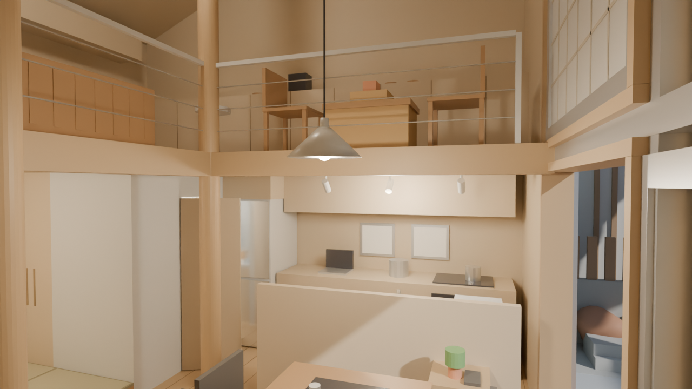
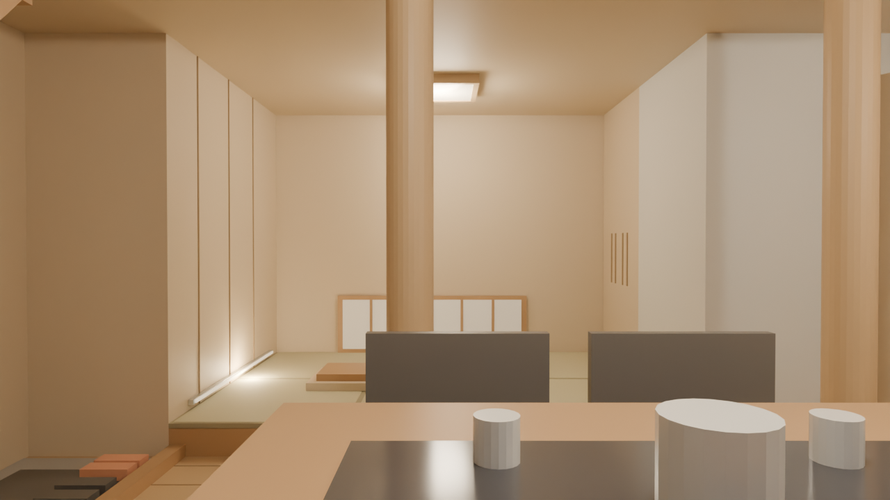

# 9TsuboV2 — 4-Mode WebXR, Apple USDZ & Architectural Digital Twin

- **Live 4-Mode WebXR Experience:** [https://spinorama.github.io/9TsuboV2/](https://spinorama.github.io/9TsuboV2/)
- **Apple iOS (USDZ) & Android AR Launcher:** [https://spinorama.github.io/9TsuboV2/ar.html](https://spinorama.github.io/9TsuboV2/ar.html)
- **Changelog:** [CHANGELOG.md](./CHANGELOG.md) (current version: **`v0.5.0`**)

Interactive 3D / WebVR / WebAR / Apple AR Quick Look architectural walkthrough of the **9-Tsubo House (*Sumire Aoi House*, 1999 by Makoto Koizumi / Koizumi Studio)** — built with Blender 5.2 LTS, Three.js (`r170`), WebXR, and Google `<model-viewer>` for **Desktop**, **Apple iPhone / iPad / Vision Pro (Native USDZ)**, **Android Chrome (Pixel 10 Pro WebXR & ARCore)**, and **Meta Quest (Quest 3 & Quest Pro)**.

---

## Mobile / AR Performance Budget (`v0.5.0`)
| Asset | Scope | Triangles | File Size | Target Platform |
| :--- | :--- | ---: | ---: | :--- |
| [`9_tsubo_house.glb`](./9_tsubo_house.glb) | Full House + Roof + Fixtures + Neighborhood Context | `56,538 tris` | `2.33 MB` | Desktop 3D, Quest VR, Android WebXR |
| [`assets/9_tsubo_house_1to1.usdz`](./assets/9_tsubo_house_1to1.usdz) | House + Roof + 36 Modeled Light Fixtures (`1:1` Scale) | `10,130 tris` | `278 KB` | Apple iOS / iPadOS / visionOS Quick Look (`1:1` Walk) |
| [`assets/9_tsubo_house_tabletop.usdz`](./assets/9_tsubo_house_tabletop.usdz) | Full Site + Context (`1:50` Tabletop `0.66m × 0.65m`) | `56,538 tris` | `2.11 MB` | Apple iOS / iPadOS / visionOS Quick Look (Tabletop) |
| [`assets/9_tsubo_house_1to1.glb`](./assets/9_tsubo_house_1to1.glb) | House + Roof + Fixtures (`1:1` Scale) | `10,130 tris` | `792 KB` | Android `<model-viewer>` / Scene Viewer (`1:1`) |
| [`assets/9_tsubo_house_tabletop.glb`](./assets/9_tsubo_house_tabletop.glb) | Full Site + Context (`1:50` Tabletop) | `56,538 tris` | `2.32 MB` | Android `<model-viewer>` / Scene Viewer (Tabletop) |

> Strictly capped under `60,000` triangles total (`~10k` house mesh) for instantaneous mobile loading and 60fps AR tracking.

---

## 4 Viewing Modes + Apple USDZ Support (`index.html` & `ar.html`)

1. **Mode 1 — Browser 3D View (`🖥️ 1 · 3D View`)**
   - **Phone / Mobile Touch:** True **1-finger 360° orbit**, **2-finger pinch-to-zoom**, and **2-finger pan** around each viewpoint's focal pivot.
   - **Desktop Mouse & Keyboard:** Left-drag to look (`360°`), Right/Middle-drag or `Shift`+drag to pan, Scroll wheel to zoom, **`WASD` / Arrows** to walk, **`E`/`Space`** & **`Q`/`C`** up/down, **`Shift`** sprint.
   - **Calibrated Lighting & Modeled Fixtures (`💡 Light` / `[F]`):** Cycles between **Daylight (`0.88`)**, **Warm Evening (`0.84`)**, and **Soft AR (`0.76`)** with warm 2700K point lights anchored directly inside the 36 modeled Koizumi architectural fixtures (pendants, track rails, tatami hinoki drum, cove LED, wall sconces, wet-rated bath downlights).
   - **Quick Toggles:** `🏠 Roof`, `🌳 Context`, `💡 Light`, `✏️ Lines` (Hidden-Line CAD `[L]`), `📐 Style` (DIN 1451 vs. LCARS `[T]`), `🍎/🤖 AR` (`ar.html`), and `📋 v0.5`.

2. **Mode 2 — Full VR (`🥽 2 · Quest VR`)**
   - `immersive-vr` (`local-floor`) with floor point-and-teleport laser reticle, thumbstick walk/snap-turn, and floating 3D VR HUD.

3. **Mode 3 — 1:1 Scale AR Walk (`📱 3 · 1:1 AR Walk` — Android WebXR & Apple USDZ Quick Look)**
   - **Android Chrome:** Native WebXR `immersive-ar` at true `1:1` scale with calibrated soft AR passthrough exposure (no whiteout!).
   - **Apple iPhone / iPad / Vision Pro:** Launches native Apple AR Quick Look directly via [`assets/9_tsubo_house_1to1.usdz`](./assets/9_tsubo_house_1to1.usdz) (`#allowsContentScaling=0`) for life-size walk-in AR.

4. **Mode 4 — Tabletop AR (`🏡 4 · Tabletop AR` — Android WebXR, Quest Passthrough & Apple USDZ)**
   - **Android Chrome / Quest:** Displays the full `33m × 32.3m` site auto-scaled to fit your viewport with 2-finger pinch scaling and 1-finger rotation.
   - **Apple iPhone / iPad / Vision Pro:** Launches native Apple AR Quick Look with [`assets/9_tsubo_house_tabletop.usdz`](./assets/9_tsubo_house_tabletop.usdz) pre-scaled cleanly to `1:50` (`0.66m × 0.65m` architectural tabletop model with pinch zoom).

---

## Verification Renders (`v0.5.0` Calibrated Lighting & Modeled Fixtures)
| Exterior Three-Quarter (`Cam_01`) | Living, Dining & Kitchen Fixtures (`Cam_03`) |
| :---: | :---: |
|  |  |
| **2F Loft Lounge & Bed (`Cam_05`)** | **1F Tatami Room Fixtures (`Cam_08`)** |
|  |  |
